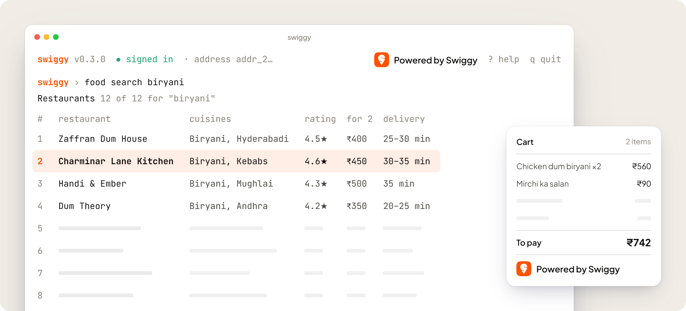
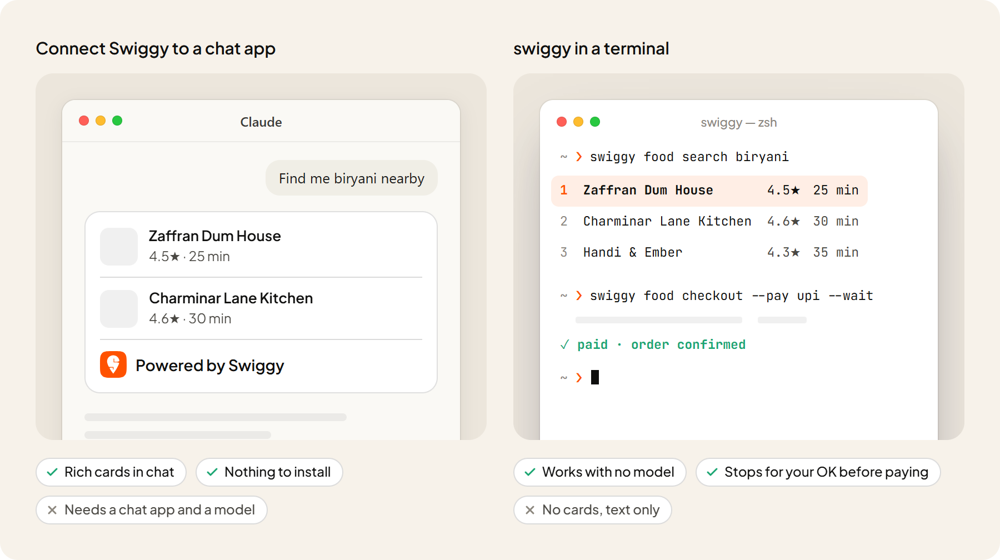
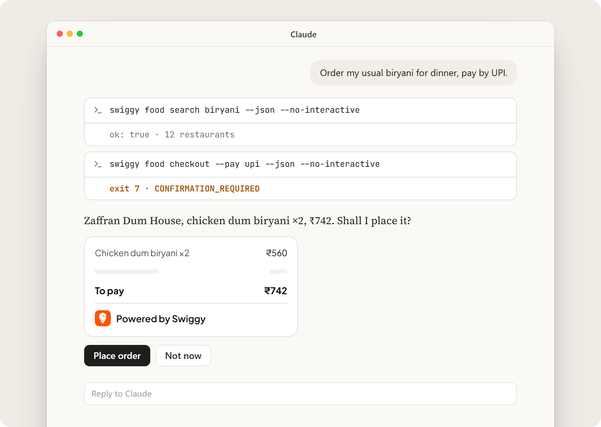
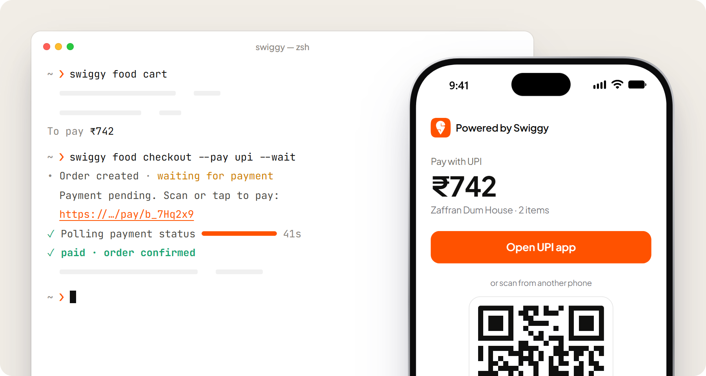
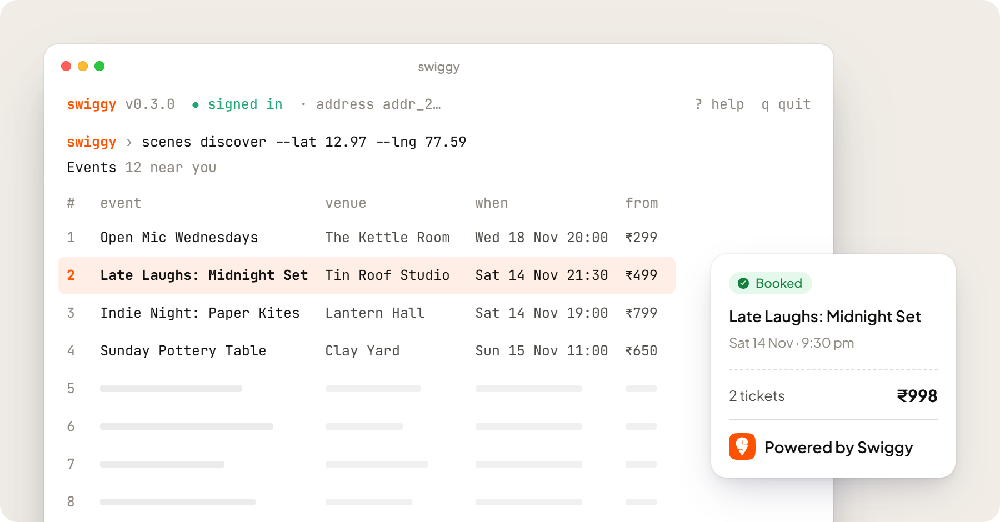

<div align="center">


# swiggy-cli

**Swiggy from your terminal: food, groceries, tables and event tickets. For people, and for agents.**

**Powered by Swiggy.**

[](https://www.npmjs.com/package/swiggy-cli)
[](https://www.npmjs.com/package/swiggy-cli)
[](https://github.com/HKTITAN/swiggy-cli/actions/workflows/ci.yml)
[](https://nodejs.org)
[](./LICENSE)

[](https://skills.sh/HKTITAN/swiggy-cli)
[](https://agent-plugins.org)

</div>

```bash
npm install -g swiggy-cli
swiggy            # full-screen app: search, arrow keys, Enter, cart, checkout — one screen
```

<a href="#the-app"></a>

`swiggy-cli` is a direct client for Swiggy's public API, covering all four services Swiggy opens to builders: **Food**, **Instamart**, **Dineout** and **Scenes**. People get a full-screen app where every result is a row you can select. Agents get one stable JSON envelope per command, fixed exit codes, and a confirmation gate on anything that spends money.

> **Powered by [Swiggy](https://mcp.swiggy.com/builders/).** This is an **independent, community-built CLI**, not an official Swiggy product. The Swiggy name and mark are trademarks of Swiggy Limited, shown unmodified per Swiggy's [brand guidelines](https://mcp.swiggy.com/builders/docs/operate/brand-guidelines/) to identify the service this tool integrates with. Listings, prices and availability come from Swiggy and are shown as received.

**Links** · [Builder docs](https://mcp.swiggy.com/builders/docs/) · [Tool reference](https://mcp.swiggy.com/builders/docs/reference/) · [Skills on skills.sh](https://skills.sh/HKTITAN/swiggy-cli) · [Wiki](./wiki) · [AGENTS.md](./AGENTS.md) · [Changelog](./CHANGELOG.md)

---

## Contents

- [Is this a wrapper over an MCP?](#is-this-a-wrapper-over-an-mcp)
- [CLI or direct connection?](#cli-or-direct-connection)
- [The app](#the-app)
- [Quick start](#quick-start)
- [For AI agents](#for-ai-agents)
- [Human mode and agent mode](#human-mode-and-agent-mode)
- [Payments](#payments)
- [Events and tickets](#events-and-tickets)
- [Auth and config](#auth-and-config)
- [Commands](#commands)
- [Architecture](#architecture)
- [Safety](#safety)
- [What's new](#whats-new)
- [Contributing, troubleshooting, license](#contributing)

---

## Is this a wrapper over an MCP?

No. Swiggy's only public API for builders is JSON-RPC over HTTPS: one `POST` per call to `mcp.swiggy.com/{food,im,dineout,scenes}` with a Bearer token. That wire format is the Model Context Protocol, which is why Swiggy's docs call the endpoints "MCP servers". `swiggy-cli` speaks it directly with `fetch`, the way `gh` speaks GitHub's GraphQL. There is no MCP SDK, no MCP client process and no model in between; `npm ls` shows three dependencies and none of them is one.

What that buys you:

- **Sanctioned.** It uses the documented OAuth flow and the documented tools, so it keeps working when Swiggy ships changes, and it never touches the private app endpoints Swiggy tells third parties not to call.
- **Nothing to run.** No server to start, no client to configure. Sign in once and type commands.
- **Everything Swiggy publishes, on the day it ships.** Named commands cover the catalog; `swiggy call <server> <tool>` reaches any tool, including ones newer than this release.

---

## CLI or direct connection?

Swiggy's servers can be reached two ways: connect them to a chat app (Claude, ChatGPT, Cursor) and let the model call the tools, or use this CLI. They are good at different things.



### For people

| | `swiggy` CLI | Swiggy connected to a chat app |
| --- | :---: | :---: |
| Works without an AI model or a chat subscription | ✅ | ❌ |
| Order with a few keystrokes; same result every time | ✅ | ❌ depends on what the model decides to do |
| Scriptable: cron, shell aliases, pipes into `jq` | ✅ | ❌ |
| Pay by UPI from where you are | ✅ link with QR, then polls and confirms | ✅ payment picker in the chat |
| Ask in plain language ("something light under ₹300") | ❌ you type commands | ✅ |
| Pictures and rich cards (menus, carts, slots) | ❌ text tables only | ✅ Swiggy's own widgets |
| Nothing to install | ❌ needs Node.js 20+ | ✅ paste a URL into the app |
| Works on a phone | ❌ | ✅ |

### For agents

| | `swiggy` CLI | Swiggy connected directly |
| --- | :---: | :---: |
| Usable from a shell, a script, CI or cron | ✅ | ❌ needs a client that speaks the protocol |
| Cost in the model's context | ✅ nothing until a command runs | ❌ 62 tool descriptions loaded up front |
| Consent before spending money | ✅ enforced: exit 7 without `--yes` | ❌ a prompt instruction the model may skip |
| Protection against a double order | ✅ never retries; flags a lost response | ❌ left to the agent (Swiggy does not de-duplicate) |
| Headless UPI: poll on Swiggy's cadence, confirm correctly per service | ✅ one flag: `--pay upi --wait` | ❌ the agent must run the loop itself |
| Errors an agent can branch on | ✅ stable codes and exit codes | ❌ a message string only |
| Ids carried between steps (rows, address, coordinates, cart) | ✅ | ❌ the agent threads them through its context |
| One sign-in shared by every agent on the machine, renewed automatically | ✅ | ❌ each client signs in separately |
| Model sees the tool schemas and picks tools itself | ❌ it must know the commands (the bundled skills teach them) | ✅ |
| Swiggy's widgets render for the user | ❌ | ✅ in chat apps that support them |
| New Swiggy tools on the day they ship | ❌ named commands wait for a release (`swiggy call` reaches them meanwhile) | ✅ |
| Works where there is no shell (hosted chat, mobile) | ❌ | ✅ |

Short version: in a chat app, connect Swiggy directly. Anywhere there is a terminal, or whenever money moves without a person watching the screen, use the CLI. The plugin in this repo sets up both.

---

## The app

`swiggy` with no arguments opens a full-screen session (also `swiggy app`). It owns the terminal the way an editor does: your scrollback survives, frames never tear, and one process keeps one connection for every command you run.

| Key | Does |
| --- | --- |
| type + Enter | run any swiggy command (`food search biryani`, `instamart search milk`, `scenes discover --lat 12.97 --lng 77.59`) |
| ↑ ↓ | move the selection over the numbered rows of the last listing |
| Enter on a row | restaurant → menu · dish/product → add 1 to cart · Dineout restaurant → slots · slot → prepare the booking · event → show times · show → hold tickets · order → details · address → make it the default |
| Tab | complete commands (shared prefix first, then the candidates) |
| c · o · a | cart · orders · addresses for the current service |
| PgUp/PgDn, Home/End | scroll the output pane |
| y / n | answer a confirmation (orders, bookings, cart clearing, address deletion ask inline) |
| ? · Esc · q | help · clear the line · quit (Ctrl+C always quits) |

The app answers its own prompts. If you have no default address it asks once, then carries the choice through the session. `swiggy shell` is the same session as a plain line-oriented REPL for terminals that cannot run the app.

---

## Quick start

```bash
npm install -g swiggy-cli

swiggy auth init                                  # browser: phone + OTP. One login for all four services
swiggy                                            # the app; or the commands below
```

```bash
swiggy food search biryani                        # numbered results…
swiggy food menu 1                                # …so the next command takes the number
swiggy food add 3 --qty 2                         # menu_item_id + restaurant filled in for you
swiggy food cart
swiggy food checkout --pay upi --wait             # scan-or-tap link → polls → confirms

swiggy instamart search milk
swiggy instamart add 1 --qty 2                    # merges into your current cart
swiggy instamart checkout --pay cash

swiggy dineout search italian --lat 12.9716 --lng 77.5946   # Dineout takes a city or area, not a saved address
swiggy dineout slots 1 --date 2026-11-14
swiggy dineout book 2 --guests 2                  # free deal books directly; paid: add --pay upi --wait

swiggy scenes discover --lat 12.9716 --lng 77.5946           # events near you, plus genre chips
swiggy scenes shows 1                             # show times and ticket types at the venue
swiggy scenes cart --show 1 --guests 2            # holds the tickets; says FREE or UPI
swiggy scenes book --pay upi --wait
```

Raw ids work everywhere a row number does. Set an address once with `swiggy profile set default defaultAddressId <id>`, and coordinates for Dineout and Scenes with `defaultLat` / `defaultLng`; otherwise the CLI asks, and remembers the answer for the following commands.

Agents and scripts add `--json --no-interactive`:

```bash
swiggy food search -q sushi --json --no-interactive | jq '.data.restaurants[0]'
```

<details>
<summary><b>Install options</b></summary>

`swiggy-cli` requires **Node.js 20+**.

```bash
npm install -g swiggy-cli        # global (recommended)
pnpm add -g swiggy-cli
yarn global add swiggy-cli
npx -p swiggy-cli swiggy <args>  # zero-install
```

A mirror is published to GitHub Packages as `@hktitan/swiggy-cli` (`--registry https://npm.pkg.github.com`, needs a GitHub token with `read:packages`); npmjs.com is canonical.

The npm package is `swiggy-cli`; it installs two binaries: `swiggy` (canonical) and `smn` (short alias).

</details>

---

## For AI agents



An agent gets one JSON object per command and a fixed exit code, and the CLI stops for a person's consent before it spends money: exit 7 means ask first, then re-run with `--yes`.

### Skills (skills.sh / Agent Skills spec)

Sixteen focused skills live under [`skills/`](./skills) and on [skills.sh/HKTITAN/swiggy-cli](https://skills.sh/HKTITAN/swiggy-cli), grouped there by [`skills.sh.json`](./skills.sh.json). Each is one `SKILL.md`, written to be strict and to explain *why*, so an agent walks the same decision tree every time.

```bash
npx skills add HKTITAN/swiggy-cli            # pick skills + agents interactively
npx skills add HKTITAN/swiggy-cli --all      # everything, every agent
npx skills add HKTITAN/swiggy-cli -s swiggy-mcp -s swiggy-mcp-payments -a claude-code
```

| Group | Skill | Teaches an agent to… |
| --- | --- | --- |
| Start here | `swiggy-cli` | drive this CLI: machine mode, envelope, exit codes, auth detection, why never to run bare `swiggy` |
| | `swiggy-mcp` | call Swiggy's servers **directly**, without the CLI: auth, reading results, errors, limits, safety rules (+ the 62-tool parameter reference) |
| Use the CLI | `swiggy-search` · `swiggy-cart` · `swiggy-checkout` · `swiggy-pay` · `swiggy-track` · `swiggy-address` · `swiggy-dineout-booking` · `swiggy-scenes` | one task each, via the CLI |
| Use Swiggy directly | `swiggy-mcp-food` · `swiggy-mcp-instamart` · `swiggy-mcp-dineout` · `swiggy-mcp-scenes` | the end-to-end journey on each server with exact parameters |
| | `swiggy-mcp-payments` | the UPI / Cash / Swiggy Money flow, widget and headless, per-server confirm contract |
| | `swiggy-mcp-docs` | look up Swiggy's docs (`llms.txt`, per-page `.md`) before writing Swiggy code |

### Plugins

- **Agent Plugins 1.0.0** ([agent-plugins.org](https://agent-plugins.org)): the repo root is a valid plugin — [`plugin.json`](./plugin.json), [`mcp.json`](./mcp.json) (the four server connections), `skills/`.
- **Claude Code**: `claude plugin marketplace add HKTITAN/swiggy-cli` then `claude plugin install swiggy@swiggy-cli` — installs the skills and pre-wires the four servers ([`.claude-plugin/`](./.claude-plugin), [`.mcp.json`](./.mcp.json)).
- Any other client: `swiggy mcp-config --client cursor|vscode|windsurf|claude|codex|plugin` prints the config to paste.

### Docs on demand

```bash
swiggy docs                                   # llms.txt index
swiggy docs reference/instamart/update_cart   # one page as Markdown
swiggy docs --full                            # everything (~630 KB)
```

See [AGENTS.md](./AGENTS.md) for the full agent contract.

---

## Human mode and agent mode

Every command builds a structured envelope first; renderers turn it into a view or a JSON line, so the two modes cannot disagree.

**Human mode** (default in a terminal): a native view per response (restaurants, menus, carts with the bill, products with pack sizes, orders, tracking, slots, bookings, events, show times, payment methods), Swiggy's own `message` rendered as Markdown, a status line with elapsed time, clickable links, an address picker, and confirmation prompts for destructive actions.

**Agent mode** flags:

| Flag | Behaviour |
| --- | --- |
| `--json` | one JSON envelope on stdout; no prose, colour or spinner |
| `--plain` | TSV: header row + rows (same column choice as the table) |
| `--raw` | Swiggy's untouched `tools/call` result |
| `--quiet` | no non-essential stderr |
| `--no-interactive` | never prompt; fail closed (also implied when stdout is not a TTY) |
| `-y, --yes` | consent for destructive tools |

Envelope:

```json
{ "ok": true, "server": "food", "tool": "search_restaurants",
  "data": { "restaurants": [ … ], "nextOffset": 10 },
  "meta": { "profile": "default", "message": "…" } }
```

`data` is the tool's own payload, read the way [Swiggy documents](https://mcp.swiggy.com/builders/docs/build/read-tool-results/): `structuredContent` when it has data, otherwise the JSON envelope in `content` (Dineout and Scenes can send the first one empty). Swiggy's `message` goes to `meta.message`, and a failed call becomes an error envelope:

```json
{ "ok": false, "error": { "code": "MCP_ERROR", "message": "Invalid addressId: required", "hint": "Run: swiggy food addresses, then retry with --address-id <id>" } }
```

### Exit codes

| Code | Meaning |
| ---: | --- |
| 0 | success |
| 1 | unknown failure |
| 2 | usage error |
| 3 | auth required / failed → `swiggy auth init` |
| 4 | not found (tool / docs page) |
| 5 | network failure (on an order-placing command, `error.details.mayHavePlacedOrder` is `true`: check your orders before trying again) |
| 6 | Swiggy tool error (`success:false`, `isError`, JSON-RPC error) |
| 7 | confirmation required (destructive tool without `--yes` in machine mode) |
| 8 | config error |
| 9 | rate limited (HTTP 429; `error.details.retryAfterSeconds`) |
| 10 | payment failed / cancelled / timed out during `--wait` |

---

## Payments



```text
payment-options → place order (Cash | UPI app | UPI link | Swiggy Money) → PENDING_PAYMENT
     → payment status (Swiggy's cadence) → confirm → PLACED → track
```

```bash
swiggy instamart payment-options                       # what this cart can pay with
swiggy instamart checkout --pay cash                   # COD: placed immediately
swiggy instamart checkout --pay upi --wait             # link → poll → confirm, one command
swiggy instamart checkout --pay upi                    # two-step: returns paasId/orderId/bridgeUrl + meta.payment.next
swiggy instamart payment-status --paas-id <p> --order-id <o> --wait
swiggy food checkout --pay upi:gpay://upi/ --wait      # a specific UPI app from payment-options
swiggy food checkout --pay swiggypay                   # Swiggy Money, when payment-options lists it
```

The link opens a page with a QR to scan on desktop and a button to open your UPI app on mobile, so the same command works on either. The CLI honours `pollingIntervalInMs` / `maxTimeToPollForInMs` from Swiggy, never tight-loops the long-poll, applies the right confirm contract per service (Food: `orderId + addressId + lat + lng`; Instamart, Dineout and Scenes: `orderId + paasId`), and never announces success on a pending order. It never asks for a UPI ID. Details: [`wiki/payments.md`](./wiki/payments.md).

---

## Events and tickets



Scenes is Swiggy's events service. The order of steps is Swiggy's, and the CLI carries the ids between them:

```bash
swiggy scenes discover --lat 12.9716 --lng 77.5946   # or --address-id <#> from `swiggy scenes locations`
swiggy scenes collection 1                           # open a genre chip from the listing
swiggy scenes search "<artist or show title>"        # a named act only; at most 4 suggestions
swiggy scenes shows 2                                # looks up the venue, then lists shows and tickets there
swiggy scenes cart --show 1 --guests 2               # FREE, UPI or UNAVAILABLE
swiggy scenes book                                   # free ticket: books directly
swiggy scenes book --pay upi --wait                  # paid ticket: link → poll → confirm
swiggy scenes status <orderId>
```

Three things worth knowing: the coordinates Swiggy resolves on `discover` are reused for every later call (Swiggy asks for exactly that); a ticket cart is good for the booking that follows it, so the CLI forgets it after 30 minutes; and there is no Cash on Scenes.

---

## Auth and config

```text
~/.swiggy/                      (override with SWIGGY_HOME)
├── config.json                 profiles, defaults, endpoint overrides
├── auth.json                   OAuth token (plaintext; mode 0600 on macOS and Linux)
├── history                     app / shell command history
└── cache/
    ├── sessions.json           handshake record per service (so repeat runs skip it)
    └── recent.json             numbered rows of the last listings + carried context
```

```bash
swiggy auth init                 # browser OAuth 2.1 + PKCE; dynamic client registration; one token for all services
swiggy auth init --no-browser    # print the URL instead (SSH sessions)
swiggy auth status               # per-service token state + expiry
swiggy auth logout
swiggy doctor                    # runtime, config, auth, OAuth metadata, live tool list, catalog drift, docs reachability
```

A sign-in lasts 5 days, and the CLI renews it for 30 more whenever you use it in the last day before it runs out, so regular use never sends you back to the browser. Swiggy cannot renew a sign-in that has already expired; after a longer gap, run `swiggy auth init` again.

Profiles hold defaults so commands stay short: `defaultAddressId` (Food/Instamart), `defaultLat` / `defaultLng` (Dineout/Scenes), `output`, and per-service `endpoints` overrides (or `SWIGGY_FOOD_URL` / `SWIGGY_INSTAMART_URL` / `SWIGGY_DINEOUT_URL` / `SWIGGY_SCENES_URL`).

---

## Commands

`swiggy --help` is complete; the short version:

| Area | Commands |
| --- | --- |
| Sessions | `app` (default with no arguments) · `shell` |
| Generic | `servers` · `tools <server> [--offline]` · `schema <server> <tool>` · `call <server> <tool> --input <json>` · `docs [path]` · `mcp-config` · `doctor` |
| Food | `search` · `search-menu` · `menu` · `addresses` · `create-address` · `delete-address` · `cart` · `add` · `clear-cart` · `list-coupons` · `apply-coupon` · `checkout` · `orders` · `order` · `track` · `delivery-status` · `payment-options` · `payment-status` · `confirm-order` · `report-error` |
| Instamart (`im`) | `search` · `go-to-items` · `addresses` · `create-address` · `delete-address` · `cart` · `add` · `set-cart` · `clear-cart` · `checkout` · `orders` · `track` · `delivery-status` · payment/support as above |
| Dineout | `search` · `details` · `slots` · `cart` · `book` · `status` · payment/support as above |
| Scenes (`events`) | `locations` · `discover` · `search` · `collection` · `details` · `venue` · `shows` · `cart` · `show-cart` · `book` · `status` · payment/support as above |
| Auth/config | `auth init\|status\|whoami\|logout` · `config show\|path\|init` · `profile list\|use\|create\|delete\|set` |

Five commands call tools Swiggy stopped publishing in November 2026 and are marked `[legacy]` in `--help`: `instamart list-coupons`, `instamart apply-coupon`, `instamart order`, `dineout cancel`, `dineout locations`. Swiggy enables tools per account, so they work only if yours still has them; `swiggy doctor` tells you.

Full mapping with flags: [`wiki/commands.md`](./wiki/commands.md). Swiggy's catalog with parameters, generated from their docs: [`wiki/tools-catalog.md`](./wiki/tools-catalog.md).

---

## Architecture

```text
swiggy (no args) ──► src/tui/app.ts   full-screen session: keypresses, output pane, prompts, status sink
swiggy <verb>    ──► named command (documented params) ──► swiggy call <server> <tool>
                                                              └── src/lib/mcp.ts · fetch · JSON-RPC over HTTPS · JSON or SSE
                                                                  ├── handshake remembered per service, redone once if rejected
                                                                  ├── 401 → refresh token, retry once · 419 / -32001 → sign in again
                                                                  ├── 429 → RATE_LIMITED with Retry-After
                                                                  └── https://mcp.swiggy.com/{food,im,dineout,scenes}
```

- `src/commands/*` — verbs; `payments.ts` and `address.ts` are shared across services; `shell.ts` runs a command line in-process.
- `src/tui/app.ts` — the full-screen app. Commands run in-process with their output captured into the pane; prompts and progress go through two small interfaces (`lib/prompter.ts`, the status sink in `lib/ui.ts`) that the app implements.
- `src/lib/mcp.ts` — the API client; `auth.ts` — OAuth (RFC 9728/8414 discovery, dynamic registration, PKCE, refresh); `payments.ts` — pure payment-flow logic; `aliases.ts` — the 62-tool catalog; `recent.ts` — numbered rows and carried context.
- `src/lib/term.ts` + `ui.ts` — terminal capability detection and the status line.
- `scripts/gen-tools-reference.mjs` — regenerates the tool references from Swiggy's docs; `npm run check:tools` fails when the catalog in the code no longer matches.
- Tests: unit (`aliases`, `payments`, `envelope`), the client and token refresh against a mock server, black-box tests of the built binary (including the full Scenes booking path), and the app and shell driven end to end through fake terminals. `npm test` builds first.
- `readme-scenes/` — the source of the product shots on this page, built with Benji Taylor's Stageshow kit (illustrations of the CLI, not screenshots; restaurant and event names are invented). Not shipped to npm.

More: [`wiki/architecture.md`](./wiki/architecture.md).

---

## Safety

- Destructive tools — `place_food_order`, `checkout`, `book_table`, `place_event_order`, `cancel_booking`, `flush_food_cart`, `clear_cart`, `delete_address` — ask for confirmation, or need `--yes` in machine mode.
- Order placement is never retried automatically. Swiggy does not de-duplicate these calls, so a retry after a lost response can place a second order; check `orders` / `status` first.
- Food and Instamart orders cannot be cancelled through the API. Swiggy customer care: 080-67466729.
- The token lives in plaintext at `~/.swiggy/auth.json`. On macOS and Linux the file is created with mode 0600; Windows ignores that mode, so the file is as private as your user profile. Nothing secret is printed in human or JSON mode; `--raw` echoes Swiggy's literal response by design. No telemetry; the CLI talks only to `mcp.swiggy.com`.

---

## What's new

### 0.3.0 (November 2026)

- **Scenes.** Swiggy's fourth service, events and tickets, end to end: `swiggy scenes discover → shows → cart → book`.
- **Sign-ins now renew.** Token refresh never actually ran before, so every login ended after 5 days. It now renews ahead of expiry and once more on a rejected call.
- **Dineout results that came back empty are fixed.** Results are read the way Swiggy documents, including the fields it puts next to `data`.
- **Dineout search takes coordinates.** Swiggy dropped saved-address search for Dineout; use `--lat/--lng` or profile defaults.
- **No more invented rate-limit numbers.** Swiggy publishes none and sends no quota headers; `meta.rateLimit` is gone.
- **Caught up with Swiggy's catalog:** 62 tools across four services, with the tool references now generated from Swiggy's own docs.

Full list: [CHANGELOG.md](./CHANGELOG.md).

### 0.2 (September 2026)

The full-screen app, the shared Payment stage (`--pay cash|upi|upi:<app>|swiggypay [--wait]`), numbered rows, skills, plugin manifests, `swiggy docs`, `swiggy mcp-config`, and the [`llm-wiki/`](./llm-wiki) research wiki.

---

## Contributing

```bash
npm ci && npm run lint && npm test && npm run validate:skills && npm run check:tools
```

See [CONTRIBUTING.md](./CONTRIBUTING.md) and [`wiki/releasing.md`](./wiki/releasing.md).

## Troubleshooting

`swiggy doctor` first. Common cases in [`wiki/troubleshooting.md`](./wiki/troubleshooting.md): `AUTH_REQUIRED` after a long gap (re-run `auth init`), `Missing address id` in machine mode (pass `--address-id` or set `defaultAddressId`), Dineout or Scenes "missing coordinates" (pass `--lat/--lng` or set `defaultLat` / `defaultLng`), a `[legacy]` command failing (your account no longer has that tool), `npx swiggy` not found (`npx -p swiggy-cli swiggy`), the app in a terminal without raw-mode support (use `swiggy shell`).

## License

[MIT](./LICENSE) for this CLI's code. Powered by Swiggy: the upstream servers, listings and content are operated and owned by Swiggy Limited under their own terms; see <https://mcp.swiggy.com/builders/docs/>. This is an independent, community-built tool, not an official Swiggy product.
